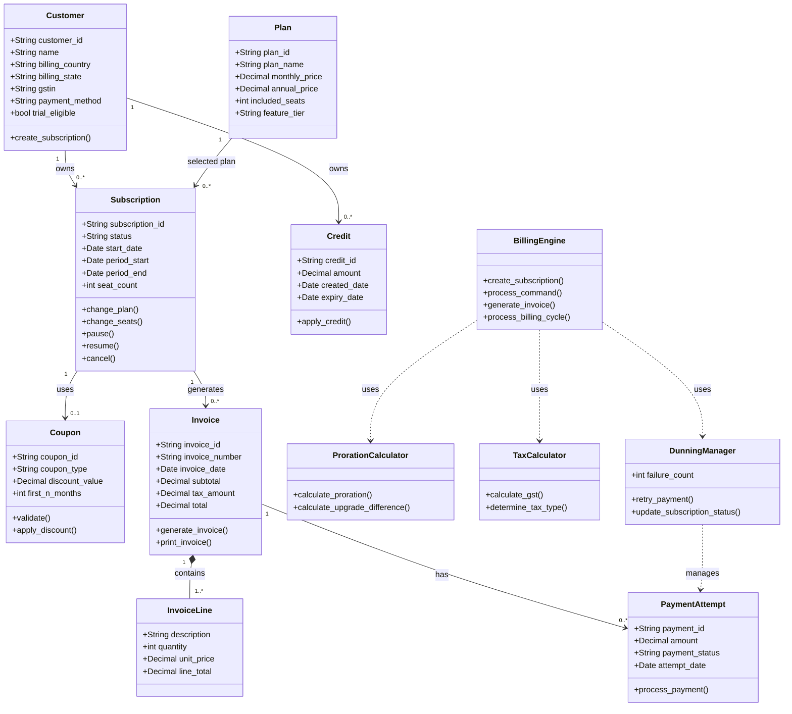

# SaaS Subscription Billing - Class Diagram

## Purpose
This diagram represents the main classes required to develop
the SaaS Subscription Billing Engine.

## Main Class Responsibilities

1. Customer: Stores customer and billing information.
2. Plan: Stores monthly and annual plan prices and seat details.
3. Subscription: Manages subscription status, seats, plan changes, pause and cancellation.
4. Coupon: Applies discounts to subscription invoices.
5. Credit: Stores customer account credits and expiry details.
6. Invoice: Generates and stores billing invoices.
7. InvoiceLine: Stores individual charges in an invoice.
8. PaymentAttempt: Records payment attempts and their results.
9. ProrationCalculator: Calculates charges for mid-cycle changes.
10. TaxCalculator: Calculates the applicable GST.
11. DunningManager: Handles failed payments and retry schedules.
12. BillingEngine: Coordinates the overall billing process.
