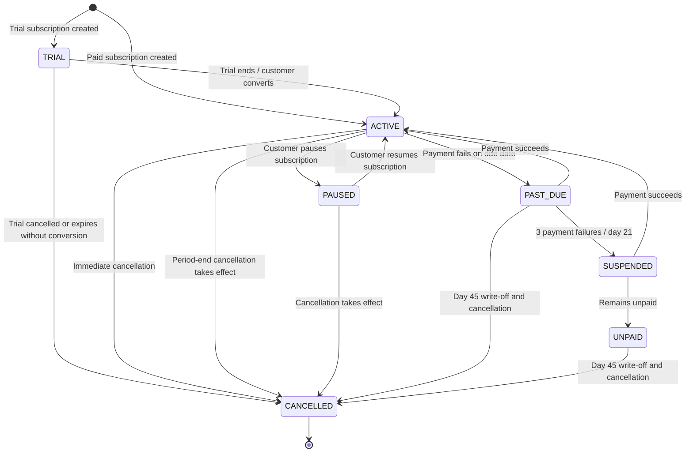

# Subscription State Diagram

## Purpose
This diagram represents the lifecycle of a SaaS subscription, including
trial, activation, pause, payment failure, suspension and cancellation.

## Important Notes
- TRIAL represents the 14-day free trial period.
- ACTIVE means the subscription is currently working.
- PAUSED means billing and subscription access are paused according to the pause rules.
- PAST_DUE means a payment has failed and retries are in progress.
- SUSPENDED means the customer has entered restricted, read-only access.
- UNPAID means the subscription remains unpaid after the specified dunning period.
- CANCELLED means the subscription has ended.
- A successful payment during the retry or suspension period restores ACTIVE status.
- Period-end cancellation takes effect only when the current billing period ends.
